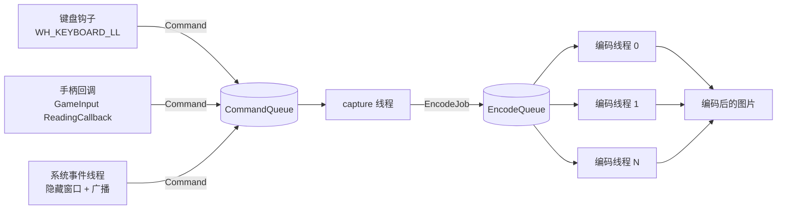
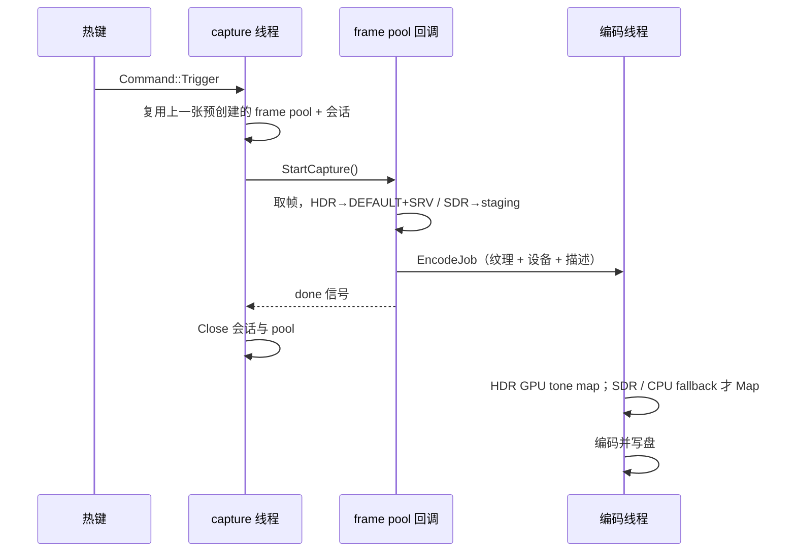

# 架构与并发模型

## 线程与队列



| 线程 | 职责 |
| --- | --- |
| input | 全局键盘钩子、GameInput 读数回调；只投递 `Command::Trigger` |
| system-events | 隐藏的 top-level 窗口，接收显示 / 设备 / 电源广播并投递命令 |
| capture | 捕获资源的唯一所有者：建 pool、`StartCapture`、等待完成、关闭 |
| encode × N | `Map/Unmap` 取像素、格式转换、编码写盘 |

队列直接用 `moodycamel::BlockingConcurrentQueue`，不额外封装：

- 入队无界、非阻塞，可以在键盘钩子回调里调用；
- 消费端阻塞等待，不做超时轮询；capture 线程靠 `CommandKind::Shutdown` 退出，编码线程靠 `EncodeJob::stop` 哨兵退出；
- 消息内的 `shared_ptr` 负责跨线程生命周期（`EncodeJob` 持有 staging 纹理与 D3D 设备）。

文件名用 `std::chrono::system_clock`（`Clock`）；阶段耗时用 `std::chrono::steady_clock`（`SteadyClock`），系统时间校准不会让延迟出现负值。

## 一次截图



回调只做 GPU 侧工作，`Map/Unmap` 留给编码线程；`done` 只表示帧已经拷进目标纹理，不表示已经写盘。
编码线程完成一张图后打印一条端到端延迟：

```text
[#0012] ...\GameSnap_20261028_121923_537_0012.avif 1920x1200 avif
  按键→StartCapture 0.03ms | StartCapture→首帧 16.4ms |
  GPU 拷贝 0.4ms | 取像素 0.8ms | 转换 2.2ms | 写盘 24.7ms | 按键→落盘 43.4ms
```

## 会话与资源生命周期

Windows.Graphics.Capture 的 `GraphicsCaptureSession` 只有 `StartCapture()` 和 `Close()`，没有 `StopCapture()`，
关闭后不能重新启动。因此：

- 启动或重建时创建：D3D 设备（优先目标显示器所属适配器）、`GraphicsCaptureItem`、编码线程；
- 每张截图使用一套独立的 `Direct3D11CaptureFramePool` + `GraphicsCaptureSession`，以及**只属于这个 pool 的 `FrameSink`**：
  `CreateFreeThreaded` → 注册 `FrameArrived` → `CreateCaptureSession` → arm shot → `StartCapture`；
- 每张图先等 `done`，再等该 pool 的回调真正退出（`wait_idle`），然后才关闭会话和 pool；
  回调 2 秒内不退出说明驱动卡住，此时不调用 `Close()`，直接放弃这一代资源；
- 上一张结束后会为下一张预创建 pool/session；这是为了压低热键到 `StartCapture` 的延迟，**不预分配截图纹理**；
- 每张图的 shot 只交给本 pool 的 sink，旧 pool 的迟到回调不可能取走下一张截图的 shot；
- `Direct3D11CaptureFrame` 一旦从 `TryGetNextFrame()` 取出，就持有自己的 D3D 纹理引用；`GraphicsCaptureSession` /
  `Direct3D11CaptureFramePool` 关闭后，这个 frame 仍然可以安全 `Map` / `CopyResource`。当前仍然先等回调退出再关闭，
  是为了避开池/会话的驱动生命周期竞态，而不是 frame 的数据依赖 pool；官方 `CaptureSnapshot` 示例也是先关 pool 再消费已取出的帧；
- 不复用 pool：同一个 pool 在关闭会话后再次 `CreateCaptureSession`，部分驱动上会偶发 `0x8000FFFF`；
- 连按热键时多出的 `Trigger` 在 `CommandQueue` 排队，逐张处理。

没有做常驻采集：屏幕静止时 WGC 不产生新帧，常驻反而可能等不到帧；Win10 上还会一直显示捕获边框并占用 GPU。

## 并发规则

1. `CaptureResources`（item / pool / session）只在 capture 线程创建、使用、销毁。
2. `FrameArrived` 在 frame pool 的工作线程上串行投递；每个 pool 一个独立 `FrameSink`，回调只接触本 pool 的 sink 和 shot。
3. `ID3D11DeviceContext` 不是线程安全的：回调线程的 `CopyResource` 与编码线程的 `Map` / `Unmap` 共用 `D3DContext::context_mutex()`；`CopyResource` 后由 `D3DContext` 的 fence 发布完成值；编码线程在锁外等待 fence/event，再在锁内 `Map` / `Unmap`。`Map` 返回后的逐行 `memcpy` 只是普通 CPU 读内存，在锁外并行执行，转换和写盘也在锁外。ToneMapper 同样使用 fence + event 等待。
4. 资源按“代”整体替换：先建好新一代，全部成功后才替换，失败则旧代继续工作。
5. 退出顺序：先停 input 和 system-events，再给 capture 投递 `Shutdown`，最后给编码线程投递 `stop`；生产者先停，消费者后停。
6. 采集纹理不做缓存：每张截图在 `FrameArrived` 回调里按需新建 `TextureSlot`。HDR 为 DEFAULT+SRV，SDR 为 staging；纹理由 `EncodeJob` 持有，编码完成后随 job 释放。`TextureSlot` 不再有 `busy` 标记，也不需要跨线程复用判断。

## 显示器与设备变化

| 事件 | 处理 |
| --- | --- |
| `WM_DISPLAYCHANGE` | 廉价自检（分辨率 / 旋转 / HDR / 显示器真变了才重建） |
| `WM_SETTINGCHANGE` | 廉价自检 |
| `WM_DEVICECHANGE` | 只检查设备/显示器句柄与 DXGI 工厂，不枚举输出（避免 USB 事件反复触发 DXGI 枚举） |
| `WM_POWERBROADCAST` 恢复 | 强制重建 |
| `EVENT_SYSTEM_FOREGROUND` | `monitor=foreground` 时，前台窗口所在屏变化才触发自检 |
| 每次截图前 | 只检查 D3D 设备是否移除 |

自检失败时重建：重新选显示器 → 新 D3D 设备 → 新 item / pool / 会话。
旧设备仍被在途编码任务持有时不会释放，只是不再使用。

## 编码与 HDR 输出

- 非 HDR：捕获纹理转 BGRA8，按 `format_sdr` 编码 BMP / PNG / JPEG / WebP / AVIF / HEIC。
- HDR：同一帧写 `_HDR.<format_hdr>`（10-bit PQ/BT.2020 AVIF 或 HEIC）和 `_SDR.<format_sdr>`。
- HDR 的 PQ OETF 与 SDR 色调映射在同一个 D3D11 compute dispatch 完成：FP16 → BT.2020 nit → PQ（HDR）；
  同一 texel → BT.709 亮度 → Hermite shoulder（spline）→ sRGB（SDR）。`analysis` 是 false color 调试算法。
- 每个 HDR job 临时创建自己的 `ToneMapper`，map 完随 job 析构；GPU 用 `ID3D11Fence` + event 等待，
  等待期间不持 `context_mutex`，避免阻塞 capture 回调。不再有跨线程共享的常驻 mapper / mapper mutex。
- 每个编码 job 临时分配 `raw` / `sdr` / `hdr10` 缓冲，编码完成后立即释放；不再使用 `thread_local EncodeScratch`。
- SDR AVIF 内嵌 ISO 21496-1 gain map；HEIC 的 libheif 1.23 没有 gain map 写入 API，只输出 SDR 基图。
- 文件名：`<前台窗口标题>_YYYYMMDD_HHMMSS_mmm_序号[_HDR|_SDR].<扩展名>`；标题在命令出队时取，非法字符替换为 `_`。

## 内存与显存分配策略

为了降低长时间闲置时的常驻占用，并避免多线程争用同一份缓存，当前不保留以下预分配：

- capture 的 SDR staging 纹理 / HDR DEFAULT+SRV 纹理；
- 编码线程的 `raw` / `sdr` / `hdr10` 大缓冲；
- `ToneMapper` 的 HDR/SDR 输出与 readback 纹理。

这些资源全部按 job 动态创建，并在编码结束、`EncodeJob` 析构时释放。`ToneMapper` 现在每个 HDR job 一个，
不再由多个编码线程共享，因此也没有 `mapper_mutex_` 和 30 秒熔断状态。

仍保留的预分配 / 常驻项：

- 16KB 的色调映射 LUT：HDR 时缓存，SDR job 结束后释放，下一张 SDR 再按需重建；
- WGC 的 `Direct3D11CaptureFramePool` / `GraphicsCaptureSession`：上一张结束后预创建下一套，用于压低热键延迟；
- libjpeg 的 `thread_local cinfo` 与行缓冲：`longjmp` 会跳过普通局部对象析构，不能安全改成每张分配，属于非纹理的小缓冲。

取舍：

- 闲置时不再常驻全尺寸 capture 纹理、编码 scratch 和 ToneMapper 纹理，4K 下可省下数百 MiB 的峰值/常驻占用；
- 每张截图会增加纹理创建、ToneMapper 初始化和 vector 重新分配开销；HDR 连拍时分配/释放更频繁；
- 不再有纹理缓存的 `busy` 跨线程竞争，资源生命周期由 `EncodeJob` 的 `shared_ptr` 直接表达；
- WGC pool/session 仍预创建，不属于截图纹理缓存；如果需要进一步降低闲置显存，可再关闭这条预创建路径，但会增加热键到 `StartCapture` 的延迟。

## 内存分配失败

项目不逐处处理 `std::bad_alloc`。启动时通过 `std::set_new_handler` 安装处理器：向 stderr 写固定消息，
记录 critical 日志并调用 `cpptrace::generate_trace().print_with_snippets()` 打印调用栈，然后 `std::abort()`。
处理器进入后先执行 `std::set_new_handler(nullptr)`，打印栈时再次 OOM 不会再递归进入处理器。因此分配失败
不会沿调用栈传播，也不会留下 mapped 纹理、半初始化 pool 等中间状态。

显式 `new` 保持原来的 `std::shared_ptr<T>(new T(...))` 写法，不使用 `std::nothrow`，也不在构造处判空；
分配失败统一由上面的处理器终止。
