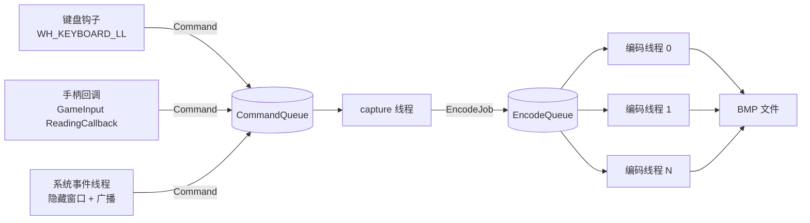
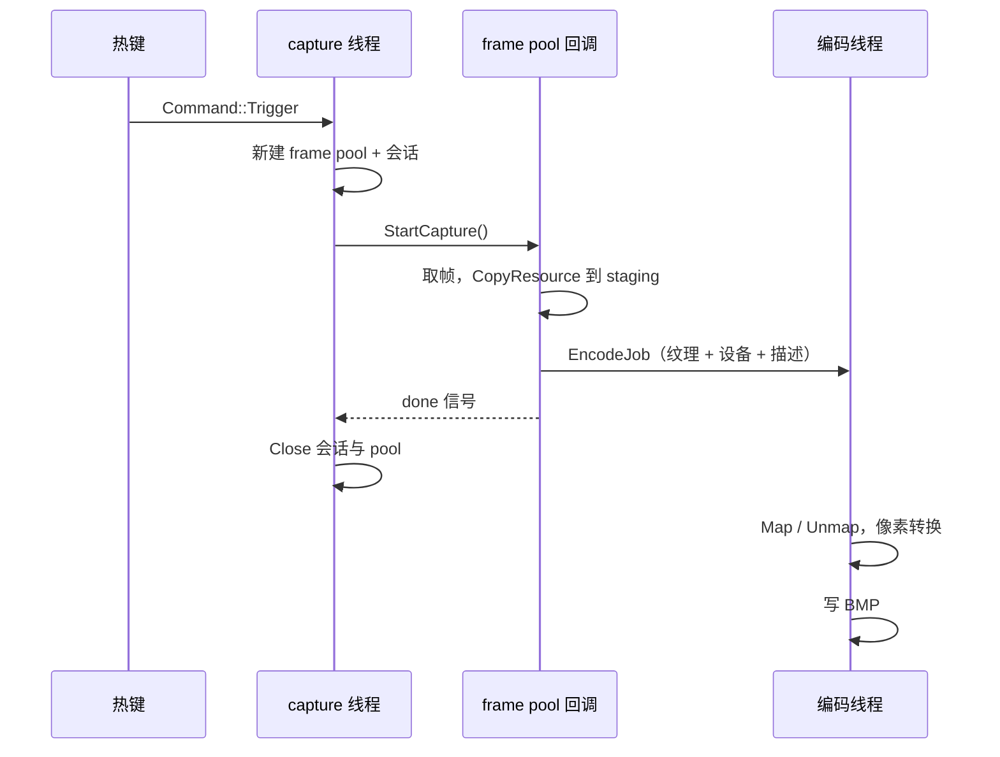

# 架构与并发模型

## 线程与队列



| 线程 | 职责 |
| --- | --- |
| input | 全局键盘钩子、GameInput 读数回调；只投递 `Command::Trigger` |
| system-events | 隐藏的 top-level 窗口，接收显示 / 设备 / 电源广播并投递命令 |
| capture | 捕获资源的唯一所有者：建 pool、`StartCapture`、等待完成、关闭 |
| encode × N | `Map/Unmap` 取像素、格式转换、BMP 写盘 |

队列直接用 `moodycamel::BlockingConcurrentQueue`，不额外封装：

- 入队无界、非阻塞，可以在键盘钩子回调里调用；
- 消费端阻塞等待，不做超时轮询；capture 线程靠 `CommandKind::Shutdown` 退出，编码线程靠 `EncodeJob::stop` 哨兵退出；
- 消息内的 `shared_ptr` 负责跨线程生命周期（`EncodeJob` 持有 staging 纹理与 D3D 设备）。

文件名用 `std::chrono::system_clock`（`Clock`）；阶段耗时用 `std::chrono::steady_clock`（`SteadyClock`），系统时间校准不会让延迟出现负值。

## 一次截图



回调只做 GPU 侧工作，`Map/Unmap` 留给编码线程；`done` 只表示帧已经拷进 staging，不表示已经写盘。
编码线程完成一张图后打印一条端到端延迟：

```text
[#0012] ...\GameSnap_20261028_121923_537_0012.bmp 1920x1200 bmp
  按键→StartCapture 0.03ms | StartCapture→首帧 16.4ms |
  GPU 拷贝 0.4ms | 取像素 0.8ms | 转换 2.2ms | 写盘 24.7ms | 按键→落盘 43.4ms
```

## 会话与资源生命周期

Windows.Graphics.Capture 的 `GraphicsCaptureSession` 只有 `StartCapture()` 和 `Close()`，没有 `StopCapture()`，
关闭后不能重新启动。因此：

- 启动或重建时创建：D3D 设备（优先目标显示器所属适配器）、`GraphicsCaptureItem`、主 staging 纹理、编码线程；
- 每张截图新建一套 `Direct3D11CaptureFramePool` + `GraphicsCaptureSession`，以及**只属于这个 pool 的 `FrameSink`**：
  `CreateFreeThreaded` → 注册 `FrameArrived` → `CreateCaptureSession` → arm shot → `StartCapture`；
- 每张图先等 `done`，再等该 pool 的回调真正退出（`wait_idle`），然后才关闭会话和 pool；
  回调 2 秒内不退出说明驱动卡住，此时不调用 `Close()`，直接放弃这一代资源；
- 每张图的 shot 只交给本 pool 的 sink，旧 pool 的迟到回调不可能取走下一张截图的 shot；
- 不复用 pool：同一个 pool 在关闭会话后再次 `CreateCaptureSession`，部分驱动上会偶发 `0x8000FFFF`；
- 连按热键时多出的 `Trigger` 在 `CommandQueue` 排队，逐张处理。

没有做常驻采集：屏幕静止时 WGC 不产生新帧，常驻反而可能等不到帧；Win10 上还会一直显示捕获边框并占用 GPU。

## 并发规则

1. `CaptureResources`（item / pool / session）只在 capture 线程创建、使用、销毁。
2. `FrameArrived` 在 frame pool 的工作线程上串行投递；每个 pool 一个独立 `FrameSink`，回调只接触本 pool 的 sink 和 shot。
3. `ID3D11DeviceContext` 不是线程安全的：回调线程的 `CopyResource` 与编码线程的 `Map` / `Unmap` 共用 `D3DContext::context_mutex()`；`Map` 返回后的逐行 `memcpy` 只是普通 CPU 读内存，在锁外并行执行，转换和写盘也在锁外。
4. 资源按“代”整体替换：先建好新一代，全部成功后才替换，失败则旧代继续工作。
5. 退出顺序：先停 input 和 system-events，再给 capture 投递 `Shutdown`，最后给编码线程投递 `stop`；生产者先停，消费者后停。
6. staging 纹理只有一块，用一个显式的 `atomic<bool>` 占用标记：编码线程 Map 完立刻释放，截图时标记已占用就临时新建一块，不依赖 `shared_ptr::use_count`。

## 显示器与设备变化

| 事件 | 处理 |
| --- | --- |
| `WM_DISPLAYCHANGE` | 廉价自检（分辨率 / 旋转 / HDR / 显示器真变了才重建） |
| `WM_SETTINGCHANGE` | 廉价自检 |
| `WM_DEVICECHANGE` | 只检查设备/显示器句柄与 DXGI 工厂，不枚举输出（避免 USB 事件反复触发 DXGI 枚举） |
| `WM_POWERBROADCAST` 恢复 | 强制重建 |
| 每次截图前 | 设备是否移除、`HMONITOR` 是否有效、DXGI 工厂 `IsCurrent()` |

自检失败时重建：重新选显示器 → 新 D3D 设备 → 新 item / pool / 会话 → 新主 staging 纹理。
旧设备仍被在途编码任务持有时不会释放，只是不再使用。

## 编码

- 只写 BMP：`BITMAPFILEHEADER + BITMAPINFOHEADER + 32bpp BGRA`，`std::ofstream` 落盘，不用 WIC / libpng / libjpeg；PNG / JPEG 留作 TODO。
- 像素统一转成 32bpp BGRA；HDR 的 FP16 在这一步色调映射。
- HDR（`--hdr` 且显示器为 HDR）：以 `R16G16B16A16Float` 捕获，按显示器色彩空间做 PQ / scRGB → sRGB 转换，SDR 白点来自 `DisplayConfigGetDeviceInfo`；用 16K 项 LUT 避免逐像素 `pow`。
- 文件名：`<前台窗口标题>_YYYYMMDD_HHMMSS_mmm_序号.bmp`；标题在触发热键时取，非法字符替换为 `_`，空标题回退 `GameSnap`。

## 已知限制

- 必须在交互式桌面、中等完整性级别运行；沙盒 / AppContainer / 服务会话里 WGC 会返回 `E_ACCESSDENIED`。
- 全局键盘钩子受 UIPI 限制：管理员权限的游戏里，非管理员的本工具可能收不到按键。
- Win10 不支持 `IsBorderRequired(false)`，截图瞬间会闪一下黄色捕获边框。
- 只支持整显示器，不支持窗口 / 区域 / 多显示器拼接。
- HDR 输出是映射到 SDR 的 8bit BMP，不是 HDR 原图。
- 手柄热键依赖 GameInput 运行时；Windows 11 自带，旧系统需安装 `GameInputRedist.msi`。
