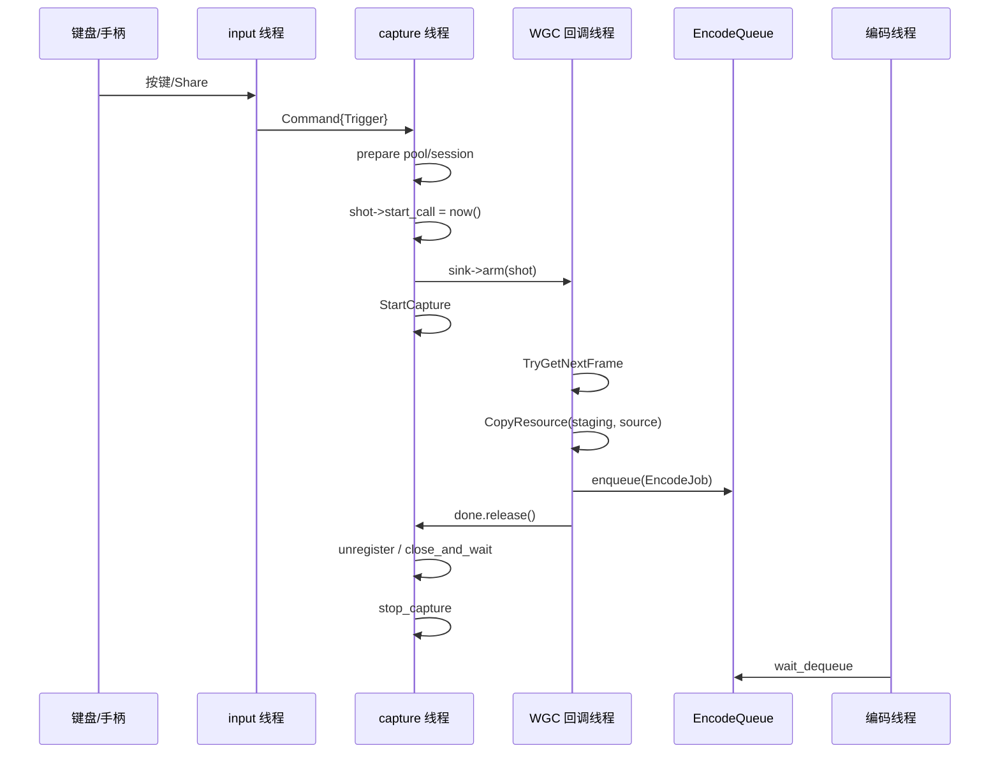

# GameSnap 并发、锁与编码流水线

本文只讨论并发与线程安全，不重复功能说明。目标是把“谁在哪个线程读写什么、靠什么同步、失败时会发生什么”写成可供人工逐项审查的清单。

对应代码：

- `GameSnap/main.cpp`
- `GameSnap/capture.h/.cpp`
- `GameSnap/encoder.h/.cpp`
- `GameSnap/input.h/.cpp`
- `GameSnap/system_events.h/.cpp`
- `GameSnap/messages.h`
- `GameSnap/d3d.h`
- `GameSnap/tonemap.h/.cpp`
- `GameSnap/codecs.cpp`
- `GameSnap/common.h`

---

## 0. 先看四条核心不变量

1. **`CaptureResources`、`Direct3D11CaptureFramePool`、`GraphicsCaptureSession` 只在 capture 线程创建、使用、关闭。**
   这些对象没有自己的锁，靠“单线程所有权”保证安全。

2. **D3D11 immediate context 不是线程安全的。**
   所有 `CopyResource`、`Map`、`Unmap`、`UpdateSubresource`、`Dispatch`、`GetData` 都通过 `D3DContext::context_mutex()` 串行化。
   `Map` 不再持锁阻塞等待：编码线程的 staging Map 使用 `D3D11_MAP_FLAG_DO_NOT_WAIT`，ToneMapper 侧使用 `D3D11_QUERY_EVENT`，等待都在锁外。

3. **跨线程传递的对象一律用 `shared_ptr` 保活。**
   `ShotContext`、staging 纹理、`D3DContext`、`canceled`/`staging_busy` 原子标记都通过值拷贝或 `shared_ptr` 进入下一线程；不传递裸指针。

4. **队列无界，积压不丢。**
   `CommandQueue` 和 `EncodeQueue` 都是 `moodycamel::BlockingConcurrentQueue`。没有 `max_pending_jobs`、没有丢帧上限，这是产品决策；代价是连按时显存/内存会随在途帧增长。

---

## 1. 线程清单

| 线程 | 创建位置 | 入口 | 生命周期 | 主要职责 |
|---|---|---|---|---|
| 主线程 | 进程启动 | `wmain` | 进程全程 | 初始化日志/COM、创建 worker、等待 `stop`、按顺序收尾、join |
| capture 线程 | `main.cpp` 的 `std::jthread` | `CaptureWorker::run()` | `main` 创建到 `capture_thread.join()` | 唯一拥有 capture 资源代；消费 `CommandQueue`；每次截图建 pool/session |
| input 线程 | `InputThread::start()` | `InputThread::run()` | `input.start()` 到 `input.join()` | 低层键盘钩子消息泵；初始化 GameInput；投递 Trigger |
| system-events 线程 | `SystemEventThread::start()` | `SystemEventThread::run()` | `system_events.start()` 到 `join()` | 隐藏窗口 + WinEvent hook；投递 Validate/Reload |
| 编码线程 × N | `EncodeWorkers::start()` | `EncodeWorkers::worker_main()` | `encoders.start()` 到 `encoders.stop()` | 消费 `EncodeQueue`；Map staging、转换、GPU/CPU tone map、编码、写盘 |
| WGC FrameArrived 回调线程 | 每个 frame pool 内部（FreeThreaded 可能并发） | `FrameSink::on_frame()` | pool 存活期间 | 取帧、CopyResource 到 staging、入队、release `done` |
| GameInput 回调线程 | GameInput 内部 | `InputThread::reading_callback()` → `on_reading()` | 注册到反注册 | 读取 Xbox Share 系统键，投递 Trigger |
| 控制台 Ctrl+C 处理线程 | Windows 控制台 | `console_ctrl_handler()` | 进程全程 | 只对 `StopSource` 调 `request_stop()` |
| WinRT/COM 内部线程 | 系统 | 各异步操作 | 系统管理 | WGC/pool 的异步完成，不直接访问业务对象 |

### 1.1 COM apartment

- input、capture、system-events、main 各自在线程入口创建 `ComApartment`（`RoInitialize`/MTA）。
- 编码线程只使用 D3D11 和普通 CPU 编码库，不创建 WinRT 对象；`EncodeJob` 里的 `D3DContext`/纹理是 COM 引用计数对象，跨线程持有是安全的。
- GameInput 回调由 GameInput 自己的线程派发，`InputThread` 的反注册在 `run()` 退出前完成，返回后不再派发新回调（按微软文档语义）。

---

## 2. 对象所有权与生命周期

### 2.1 main

- 拥有 `EncodeWorkers`、`InputThread`、`SystemEventThread`、`CaptureWorker` 对象本身。
- `CaptureWorker` 被 `std::jthread` 的 lambda 以引用捕获；`main` 在离开作用域前 `capture_thread.join()`，保证对象生命周期覆盖线程。
- `std::atomic<bool> capture_crashed` 由 capture 线程入口的 catch 设置，`main` 在 join 后读取，决定退出码。
- `StopSource` 通过 `shared_ptr` + 空 deleter 故意活到进程结束，避免控制台回调拿到已释放指针；`StopSlot` 在退出时把静态槽位置空。

### 2.2 CaptureResources：按“代”整体替换

- 由 capture 线程创建、关闭；`CaptureResources` 自身没有互斥量。
- 每次截图 `prepare()` 创建新的 frame pool + session；`start_capture()` 启动。
- 重建时先完整创建新一代，全部成功后才替换 `resources_`/`d3d_`/`staging_`，旧代最后 `close()`。
- 重建期间旧 job 可能仍持有旧的 `D3DContext` 和 staging 纹理；它们通过 `shared_ptr` 保活，旧设备不会在使用中销毁。
- `abandon()` 是回调卡死时的保命路径：只释放引用，不调用 WGC `Close()`，句柄由 COM 在回调结束后回收；这是有意泄漏/延迟回收，不是正常路径。

### 2.3 ShotContext 与 EncodeJob

`ShotContext` 是“一张截图”的跨线程上下文：

- capture 线程创建并填写不可变字段（`enqueued`、`start_call`、`title`、格式、色彩空间等）；
- `start_call` 现在在 `sink->arm(shot)` **之前**写入；arm 的 mutex 发布后回调线程才可能读取，避免数据竞争；
- 每个 pool 一个独立 sink；`shot_` 在锁内 `exchange` 发布/取走。FreeThreaded pool 的回调可能并发，因此 `on_frame` 先锁内取走 shot，只有一个回调能拿到；其他回调只增加/减少 `in_flight_`。
- capture 线程自己仍持有 `shot`，等 `done` 后检查 `failed`。

`EncodeJob` 是“一次编码任务”：

- 由回调线程构造并 `enqueue`，capture 线程不再访问；
- 持有 `shared_ptr<ID3D11Texture2D>`（staging）、`shared_ptr<D3DContext>`、`shared_ptr<atomic<bool>> canceled`、`shared_ptr<atomic<bool>> staging_busy`；
- job 进入队列后字段不再修改；编码线程只读；
- `canceled` 可被 capture 线程在超时后写入，编码线程用 acquire 读取；
- `staging_busy` 由 capture 线程 exchange 抢占，编码线程完成 Map/Unmap 后 release。

### 2.4 capture 线程与 staging

- `staging_` 是唯一主 staging 纹理；`staging_busy_` 标记它是否被编码线程占用。
- 回调里：

```text
if (主 staging 匹配 && staging_busy.exchange(true, acq_rel) == false)
    复用主 staging，并把 busy 交给 job
else
    新建临时 staging（不占主 staging 标记）
```

- 如果使用主 staging，`BusyLease` 在回调提前返回/异常时释放；成功入队后所有权转给 job。
- 如果新建临时 staging，job 的 `staging_busy` 为空；纹理引用计数在 job 析构时释放。
- 编码线程在完成 staging 的 Map/memcpy 后释放 busy，允许 capture 复用它；不需要等编码/写盘完成。

### 2.5 EncodeWorkers、ToneMapper 与 ScratchPool

- `EncodeWorkers` 的 `threads_` 只由 main 在 start/stop 时访问；worker 只读 `jobs_`。
- `mapper_mutex_` 保护 `mapper_` 和 `mapper_owner_`；ToneMapper 的 D3D 资源只在该锁内访问。
- `ToneMapper` 内部持有 `shared_ptr<D3DContext>`，所以旧代设备在 mapper 被替换前不会释放；`mapper_owner_` 只用于比较指针，不解引用旧设备。
- ScratchPool 是进程级静态对象：一份 `RawCopy` + `Image sdr` + `vector<uint16_t> hdr10`，详见第 4.4 节。
- 编码线程的 `thread_local` 数据：
  - `LutCache`（16K 字节）；
  - JPEG 行缓冲（约 `width*3` 字节）。
  这两个都不是跨线程共享，且 `thread_local` 析构在各自线程退出时执行。

---

## 3. 消息与队列协议

### 3.1 CommandQueue

类型：`moodycamel::BlockingConcurrentQueue<Command>`。

生产者：

- input 线程（键盘/手柄 Trigger）；
- system-events 线程（Validate/Reload）。

消费者：

- capture 线程，使用自己的 `moodycamel::ConsumerToken`。

`Command` 字段：

```cpp
struct Command {
    CommandKind kind;      // Trigger / Validate / Reload / Shutdown
    ReloadReason reason;   // 仅 Validate/Reload 有意义
    SteadyClock::time_point enqueued;
};
```

同步语义：

- 队列内部保证元素的发布/获取；
- `enqueued` 在入队前由生产者写好，消费端读到的就是完整值；
- `Trigger` 的 `reason` 不参与业务判断；
- `Shutdown` 只由 main 在停止流程中投递，capture 在 `run()` 的 `wait_dequeue` 收到后 break。

### 3.2 EncodeQueue

类型：`moodycamel::BlockingConcurrentQueue<EncodeJob>`。

生产者：

- WGC FrameArrived 回调线程（每个 pool 串行）。

消费者：

- 每个编码线程一个 `ConsumerToken`。

停止协议：

- `EncodeWorkers::stop()` 给每个线程投递一个 `EncodeJob{.stop = true}`；
- 队列 FIFO，所以哨兵之前的 job 会先被取走；
- 每个 worker 收到 stop 后 break，main `join`；
- 没有超时；编码线程若卡在驱动/编码库内部，`join` 会一直等。

### 3.3 无界队列的已知后果

- 连续按热键时，每张图在编码完成前都占一个 staging 纹理；HDR 4K 单张约 66MB。
- `CommandQueue` 和 `EncodeQueue` 都没有上限；不会丢 Trigger，也不会丢 job。
- 这是明确的产品决策，不是遗漏。若以后要加背压，必须同时定义“丢弃新 Trigger”还是“阻塞生产者”，不能只改队列长度。

---

## 4. 锁与同步原语清单

### 4.1 `D3DContext::context_mutex`

保护对象：`ID3D11DeviceContext`（immediate context）的所有调用。

| 调用点 | 线程 | 说明 |
|---|---|---|
| `CopyResource(staging, source)` | WGC 回调 | 一帧一次，通常很短 |
| `Map` / `Unmap` staging | 编码线程 | `DO_NOT_WAIT`；未就绪时锁外重试 |
| `CopyResource(input_, hdr_texture)` | 编码线程 | ToneMapper 输入拷贝 |
| `UpdateSubresource` / `CSSet*` / `Dispatch` | 编码线程 | compute tone map |
| `CopyResource(readback, output)` | 编码线程 | GPU→CPU 回读 |
| `End(query)` / `GetData(query)` | 编码线程 | 事件查询 |
| `Map` / `Unmap` readback | 编码线程 | GPU 已完成，Map 立即返回 |

锁的临界区原则：

- 不把 `Map` 的阻塞等待放在锁内；
- 不做逐像素 CPU 处理；
- 不调用编码库；
- 不等待其他线程。

`D3D11Device` 的 `CreateTexture2D` / `CreateComputeShader` / `CreateBuffer` / `CreateQuery` / `GetDeviceRemovedReason` 不在 `context_mutex` 内；这些是 device 方法，按 D3D11 约定可在多线程调用，代码依赖这一点。

### 4.2 `FrameSink::mutex_` + `idle_cv_`

保护字段：

- `shot_`：当前等待 arm 的 ShotContext；
- `accepting_`：是否接收新回调；
- `in_flight_`：已进入 `on_frame`、尚未退出的回调数。

`on_frame` 状态机：

```text
lock:
  if (!accepting_) return
  ++in_flight_
  shot = exchange(shot_, nullptr)
unlock

if (shot) {
    handle_frame(...)   // 可能 CopyResource / enqueue
    shot->done.release()
}

lock:
  --in_flight_
notify idle_cv_
```

`close_and_wait(timeout)`：

```text
lock: accepting_ = false; shot_.reset()
notify
wait_for(in_flight_ == 0)
```

要点：

- `done.release()` 发生在 `in_flight_` 减一之前。capture 被 `done` 唤醒后调用 `close_and_wait` 时，仍可能看到 `in_flight_ == 1`，会继续等回调真正退出。
- `disarm()` 只清 `shot_`，不把 `accepting_` 设为 false；正常关闭走 `close_and_wait`。
- `on_frame` 在 `handle_frame` 外层 catch，任何异常都会 `failed = true` 并 release `done`，不会让 capture 永久等。
- `wait_idle` 使用 condition_variable，超时返回 false；超时后 capture 调用 `abandon()`，这是最后手段。

### 4.3 `EncodeWorkers::mapper_mutex_`

保护：

- `mapper_` 指针；
- `mapper_owner_` 指针；
- 间接保护 ToneMapper 的所有 D3D 资源（纹理、UAV、query、CPU 回读缓冲）。

规则：

- 只有编码线程会持有；
- 每次 HDR job 进入 `if (job.hdr)` 时 lock；
- 如果当前 mapper 不属于本 job 的 `D3DContext`，重建 mapper；
- 整个 `mapper_->map(...)` 在该锁内执行；
- `map()` 内部等待 GPU 时使用 `context_mutex` + query，不长时间持有 context 锁，但会持有 `mapper_mutex_` 最长 5 秒（超时回退）。

后果：

- HDR 色调映射在多个编码线程之间完全串行；
- SDR job 不进入该锁；
- HDR 失败回退 CPU 后，仍然在 mapper 锁作用域内吗？`mapper_lock` 的作用域只覆盖 `if (job.hdr)` 块，`map()` 返回 false 后锁释放，CPU 回退在锁外执行。见 `encoder.cpp`。

### 4.4 ScratchPool 的 `try_lock`

```cpp
struct ScratchPool {
    std::mutex mutex;
    EncodeScratch scratch;  // RawCopy + Image + hdr10
};
```

- 全进程一份；
- 编码线程用 `std::unique_lock(..., std::try_to_lock)`；
- 拿不到锁：构造局部 `EncodeScratch local`，本张图结束立即析构，不保留容量；
- 拿到锁：使用共享缓冲，锁一直持有到 `encode()` 返回；
- 共享缓冲的 `raw`/`sdr` 通过 `swap` 交换容量，避免 BGRA 路径把容量偷走；
- PNG 的 RGBA 转换缓冲是每次调用局部变量，不再 `thread_local` 常驻。

注意：共享锁覆盖整个 job（包括编码/写盘），所以第二个编码线程几乎总是拿不到共享缓冲，会走局部分配。这是“空闲只保留一份，争用时现场分配”的预期行为，不是死锁。

### 4.5 `ready_` latch

- `CaptureWorker::ready_{1}`。
- `run()` 第一行构造 `ReadyGuard`，所有 return/异常路径都会 `count_down()`。
- main 的 `wait_ready()` 是无超时 `wait()`，但 count_down 已被保证；线程创建本身失败会在 `std::thread` 构造时抛出，不会走到等待。

### 4.6 `done` binary_semaphore

- `ShotContext` 内，初值 0；
- 回调 `on_frame` 处理完（成功/失败/异常）后 `release()`；
- capture `try_acquire_for(500ms)`；
- 超时设置 `canceled = true`，然后仍会走 unregister/close_and_wait；
- 它的同步语义是“回调已经完成 staging 写入或确定失败”，**不表示编码完成**。

### 4.7 原子变量

| 原子 | 写方 | 读方 | 内存序 | 用途 |
|---|---|---|---|---|
| `ShotContext::failed` | WGC 回调 | capture | release / acquire | 帧获取/拷贝/设备移除失败 |
| `ShotContext::canceled` | capture（超时） | 回调、编码线程 | release / acquire | 取消迟到 job |
| `staging_busy` | capture（exchange）、编码线程（release） | capture/编码 | acq_rel / release | 主 staging 占用 |
| `share_latched_` | GameInput 回调线程 | 同一回调线程（可能并发？） | acq_rel / release | Share 键去重 |
| `fatal_error_` | capture | main | relaxed | 启动失败退出码 |
| `capture_crashed` | capture 线程入口 catch | main | relaxed + join | 异常退出码 |
| `InputThread::stop_` / `thread_id_` | main / input | input / main | release / acquire | 唤醒消息循环 |
| `SystemEventThread::stop_` / `thread_id_` | main / system | system / main | release / acquire | 唤醒消息循环 |
| `hook_target()` | input run | 钩子回调 | release / acquire | 静态实例指针 |
| `win_event_target()` | system run | WinEvent 回调 | release / acquire | 静态实例指针 |

`done` 的 semaphore 本身提供同步；`failed` 在 `done.release()` 之前写，capture 在 acquire 之后读，顺序有保证。

---

## 5. 锁顺序与死锁分析

### 5.1 实际存在的嵌套顺序

```text
ScratchPool::mutex
    └── EncodeWorkers::mapper_mutex_        (仅 HDR)
            └── D3DContext::context_mutex   (GPU 调用)
```

`FrameSink::mutex_` 不会和 `D3DContext::context_mutex` 同时持有：`on_frame` 在 `handle_frame` 之前就释放了 sink 锁。

### 5.2 反向路径检查

- 没有代码在持有 `context_mutex` 时去拿 `mapper_mutex_` 或 `ScratchPool::mutex`。
- 没有代码在持有 `mapper_mutex_` 时去拿 `ScratchPool::mutex`。
- `FrameSink` 的 `close_and_wait` 只持有 sink mutex 等 condition_variable，不拿 context 锁。
- `EncodeWorkers::stop()` 只 enqueue + join，不拿 mapper/scratch 锁。
- `capture` 的 `close()` / `abandon()` 不拿编码侧锁。

### 5.3 可能的长时间持锁点

| 锁 | 最长场景 | 影响 |
|---|---|---|
| `context_mutex` | 正常单次 GPU 调用；`Map` 已改为不等待 | 微秒到毫秒级 |
| `mapper_mutex_` | HDR `map()` 最长 5s 超时 | 其他 HDR 编码线程排队；SDR 不受影响 |
| `ScratchPool::mutex` | 整个 job（编码/写盘） | 其他编码线程走局部分配，不阻塞 |
| `FrameSink::mutex_` | 临界区只做指针交换/计数 | 微秒级 |

### 5.4 不能完全排除的风险

- 驱动内部 `Map`/`CopyResource` 卡死时，`context_mutex` 仍可能被卡住；代码只能通过超时路径减少业务层等待。
- `EncodeWorkers::stop()` 的 `join()` 无超时；编码库卡死会拖住退出。
- `ToneMapper` 的 GPU query 超时后回退 CPU，但驱动若一直不返回 `GetData`，每次 HDR job 仍要等 5s，不能恢复 GPU 路径。

---

## 6. 编码流水线

### 6.1 从热键到 job



关键点：

1. **每张截图一个新 pool + session**，不复用。避免部分驱动在同 pool 重开会话时的 `0x8000FFFF`。
2. **先 arm 再 StartCapture**，防止首帧早于 arm 丢失。
3. 回调只做 `TryGetNextFrame`、`CopyResource`、`enqueue`，不做 Map、不做编码。
4. capture 等 `done` 只保证“帧已经进 staging 或失败”，不等编码；因此 capture 可以继续处理下一条 Command。
5. `done` 超时 500ms 后设置 `canceled`；迟到回调即使已经取到 shot，也会在拷贝前/入队前看到 canceled，避免编码垃圾帧。

### 6.2 staging 选择

```text
if (shot.staging 匹配 && staging_busy.exchange(true) == false)
    使用主 staging；job.staging_busy = 主标记
else
    新建临时 staging；job.staging_busy = null
```

- 主 staging 被编码线程占用时，capture 不会等待，而是临时新建；这是“不阻塞采集”的代价（显存临时增加）。
- 成功入队后 `BusyLease` 把主标记所有权交给 job；入队失败/取消由 lease 析构释放。
- 回调在 `CopyResource` 后检查 `GetDeviceRemovedReason()`；失败置 `shot.failed`，不把垃圾帧入队。

### 6.3 编码 worker 主流程

```text
wait_dequeue(job)
  if job.stop: break
  BusyGuard guard(job.staging_busy)

  if canceled: return
  if !d3d || !texture: return

  try_lock ScratchPool:
      shared scratch 或 local scratch

  if job.hdr:
      lock mapper_mutex
      ensure ToneMapper for job.d3d
      mapper->map(...)  // GPU，失败则 CPU 回退
  if !gpu_ok:
      map_to_cpu(staging -> raw)
  guard.release()       // staging 可以复用
  if canceled: return

  if job.hdr:
      write HDR (hdr10 或 CPU HdrFrame)
      convert SDR (如果 GPU 失败)
      write SDR（AVIF 可带 gain map）
  else:
      convert_pixels
      write_sdr

  log timings
```

### 6.4 HDR GPU 路径（ToneMapper）

在 `mapper_mutex_` 内：

1. `ensure_size(width, height)`：必要时重建 input/output/readback/hdr textures；
2. `CopyResource(input_, hdr_texture)`；
3. 更新 constants、设置 shader/SRV/UAV；
4. `Dispatch((w+7)/8, (h+7)/8, 1)`；
5. 解绑 SRV/UAV；
6. `CopyResource(readback_, output_)` 和 `CopyResource(hdr_readback_, hdr_output_)`；
7. `End(event_query_)`；
8. 释放 `context_mutex`；
9. 锁外轮询 `GetData(event_query_, ..., 0)`，每轮短暂拿 context 锁，`S_FALSE` 时锁外 sleep 1ms，最长 5s；
10. GPU 完成后重新拿 context 锁，`Map(readback_)` / `Map(hdr_readback_)`（此时应立即可用）；
11. 逐行 `memcpy` 到 `sdr` / `hdr10`（CPU，不持 context 锁）；
12. `Unmap`。

shader 直接输出 **BGRA8**（`linear_to_srgb(sdr).bgr`），CPU 不再做 RGBA→BGRA swizzle。
HDR10 输出：PQ 输入直接量化原始 PQ 码值，避免 `PQ→nits→PQ`；scRGB 输入先转 BT.2020，再转 PQ。

### 6.5 HDR CPU 回退

触发条件：

- ToneMapper 初始化失败；
- `map()` 返回 false（包括 GPU query 5s 超时）；
- staging 格式不是 FP16；
- 其他 GPU 错误。

路径：

1. `map_to_cpu` 用 `DO_NOT_WAIT` 轮询 Map staging，逐行拷贝到 `raw`；
2. `write_hdr` 用 `HdrFrame` 构造 10-bit 数据（`hdr_to_rgba10`，PQ 输入直接量化）；
3. `convert_pixels` 做 SDR tone map（LUT + AVX2），供 `_SDR` 输出；
4. GPU 的 `hdr10` 缓冲为空，SDR AVIF 不带 gain map。

### 6.6 SDR 路径

- `map_to_cpu` 读 staging：
  - BGRA：`bgra_copy_set_alpha_row` 在拷贝时把 alpha 置 255；
  - RGBA/FP16：逐行 memcpy。
- `convert_pixels`：
  - BGRA：`swap` 到 `sdr`，若 alpha 尚未归一化则补一遍（临时 staging 的 selftest 路径）；
  - RGBA：AVX2 `bgra_to_rgba_row` 的逆序 swizzle；
  - FP16：`half_to_float_row` + tone LUT。
- `write_sdr` 按 `format_sdr` 分派到 BMP/PNG/JPEG/WebP/AVIF/HEIC。

### 6.7 HDR 输出分支

| 条件 | 输出 |
|---|---|
| `job.hdr` + GPU 成功 | `_HDR` 用 `hdr10`，`_SDR` 用 `sdr`；SDR 为 AVIF 时写 gain map |
| `job.hdr` + GPU 失败 | `_HDR` 由 CPU `write_hdr` 生成；`_SDR` 由 CPU 转换；无 gain map |
| 非 HDR | 单张 SDR 文件 |
| `sdr_format == HEIC` + HDR | 写 SDR HEIC，并 warn：libheif 无 gain map API |

### 6.8 编码结束与停止

- 编码线程在 `guard.release()` 后允许 staging 复用，但 job 里的 CPU 缓冲仍在使用；两者独立。
- `job.texture` 引用在 job 析构时释放；主 staging 的 `busy` 已提前释放，所以纹理不会被释放（capture 仍持有）。
- 停止顺序（main）：

```text
input.stop/join
system_events.stop/join
commands.enqueue(Shutdown)
capture_thread.join
encoders.stop()   // 每线程 stop 哨兵 + join
```

这样保证：

- 不再有新 Trigger 进入；
- capture 退出后不再有新 job；
- 编码线程把 stop 哨兵之前的 job 处理完；
- 所有大对象在线程退出后才销毁。

---

## 7. 失败、取消与超时矩阵

| 场景 | 处理 | 关键同步 |
|---|---|---|
| WGC 500ms 不出帧 | `canceled=true`；仍 unregister/close | `done` semaphore + release/acquire |
| 回调取帧为空 / 纹理获取失败 | `shot.failed=true`；done release | failed release/acquire |
| `CopyResource` 后设备移除 | `failed=true`，不入队；capture 重建 | `GetDeviceRemovedReason` |
| 回调超 2s 未退出 | `abandon()`，放弃本代资源 | `FrameSink` in_flight + cv |
| 编码队列入队失败 | 丢弃本张，BusyLease 释放 | lease 析构 |
| staging Map 5s 未就绪 | 放弃该 job | `DO_NOT_WAIT` 轮询 |
| ToneMapper GPU 5s 未完成 | 回退 CPU | event query + timeout |
| 编码库失败 | 记录错误，job 结束；线程继续 | try/catch 在 worker |
| 编码线程异常 | worker catch，线程继续；不 terminate | `worker_main` 外层 catch |
| capture 线程异常 | `capture_crashed=true`，请求 stop，退出码 1 | atomic + join |
| 启动 capture 资源失败 | `fatal_error_=true`，停止，退出码 1 | ready latch |

---

## 8. 已知并发风险 / 审查重点

1. **无界队列**
   连按会累积 staging。当前是产品要求；如果以后改背压，必须明确丢哪一类消息。

2. **HDR mapper 串行**
   `mapper_mutex_` 覆盖整个 GPU map；多个编码线程的 HDR 任务实际串行。SDR 不受影响。

3. **ScratchPool 共享锁覆盖整个编码**
   第二个编码线程通常拿不到共享缓冲，会现场分配。若编码线程多、图大，会频繁分配/释放；这是“空闲只保留一份”的取舍。

4. **ToneMapper 超时后的恢复**
   5s 超时只让当前 job 回退 CPU；mapper 仍保留，下一次 HDR 仍会再等 5s。驱动永久挂起时没有自动禁用 GPU 路径的机制。

5. **`abandon()` 是有意泄漏**
   回调卡死时不能安全 Close；旧代对象依赖 COM 引用计数延迟回收。审查时要确认没有正常路径调用它。

6. **Device 方法不加 context 锁**
   `CreateTexture2D` / `CreateComputeShader` 等依赖 D3D11 device 的线程安全约定；如果未来改为多设备/多线程创建资源，需要重新评估。

7. **`EncodeWorkers::stop()` 无超时**
   编码库卡死时进程退出会挂起；目前没有 watchdog。

8. **`GameInput` 回调线程**
   `share_latched_` 是原子；`on_reading` 不访问 `InputThread` 的其他可变字段。`game_input_`/`reading_token_` 只在 input 线程读写，反注册在退出前完成。

9. **WinEvent 回调线程**
   `win_event_target()` 是原子；`foreground_monitor_` 只在该线程读写；反注册先于置空/销毁。

10. **文件写入并发**
    每个编码 job 的 sequence 唯一，输出路径由 job 自己的 `local_time`/`sequence` 生成；没有共享文件句柄。

---

## 9. 人工审查 checklist

### 队列

- [ ] 是否还有未使用 producer token 的跨线程 `enqueue`？（input/system/capture 的 Trigger/Validate/Reload 使用无 token enqueue，只有 capture 的 consumer token 是线程局部的）
- [ ] stop 哨兵数量是否等于编码线程数？
- [ ] 无界队列的显存增长是否仍符合产品预期？

### 锁

- [ ] `context_mutex` 内是否新增了阻塞调用？
- [ ] `mapper_mutex_` 内是否新增了编码/写盘？
- [ ] `ScratchPool::mutex` 内是否新增了 `wait`？
- [ ] `FrameSink::mutex_` 内是否调用了 WGC/D3D？

### 原子

- [ ] `failed` 是否在 `done.release()` 之前写？
- [ ] `canceled` 是否在入队前和编码前都检查？
- [ ] `staging_busy` 是否在所有提前返回路径释放？
- [ ] `share_latched_` 是否只在 GameInput 回调线程访问？

### 生命周期

- [ ] job 是否持有 `D3DContext` 和纹理的 `shared_ptr`？
- [ ] 旧代资源是否在 job 仍在使用时被 Close？
- [ ] `abandon()` 是否只在回调超时路径调用？
- [ ] 输入/系统线程的 hook 是否在对象销毁前反注册？

### 编码流水线

- [ ] HDR GPU 成功时 `hdr10` 是否只由 ToneMapper 写？
- [ ] HDR GPU 失败时是否走 `write_hdr` + CPU `convert_pixels`？
- [ ] AVIF gain map 是否只在 `!hdr10.empty()` 且 `sdr_format==Avif` 时写？
- [ ] staging busy 是否在 Map/拷贝完成后立即释放，而不是等编码/写盘？
- [ ] 编码线程异常是否被 `worker_main` 捕获，不会 terminate？

---

## 10. 关键代码位置

| 内容 | 位置 |
|---|---|
| Command/EncodeJob 定义 | `GameSnap/messages.h` |
| FrameSink 状态机 | `GameSnap/capture.cpp` `FrameSink::on_frame/close_and_wait` |
| ShotContext | `GameSnap/capture.h` |
| staging 选择/BusyLease | `GameSnap/capture.cpp` `handle_frame` |
| start_call / arm / done 等待 | `GameSnap/capture.cpp` `shot()` |
| D3D context 锁 | `GameSnap/d3d.h` |
| Map DO_NOT_WAIT + 超时 | `GameSnap/encoder.cpp` `map_to_cpu` |
| ScratchPool | `GameSnap/encoder.cpp` `scratch_pool()` / `encode()` |
| mapper 锁 | `GameSnap/encoder.cpp` `encode()` |
| ToneMapper GPU 等待 | `GameSnap/tonemap.cpp` `ToneMapper::map` |
| 编码停止哨兵 | `GameSnap/encoder.cpp` `EncodeWorkers::stop` |
| 输入线程/hook | `GameSnap/input.cpp` |
| 系统事件线程/hook | `GameSnap/system_events.cpp` |
| 停止顺序 | `GameSnap/main.cpp` |
| 线程局部 LUT/JPEG 行 | `GameSnap/encoder.cpp` / `GameSnap/codecs.cpp` |

---

## 11. 术语

- **代（generation）**：一套 `D3DContext + CaptureResources + staging`。重建时整代替换。
- **主 staging**：capture 线程长期持有的 staging 纹理，优先复用。
- **临时 staging**：主 staging 被编码占用时新建的纹理，job 结束释放。
- **in-flight 回调**：已经进入 `FrameSink::on_frame`、尚未退出的 WGC 回调。
- **job**：一个 `EncodeJob`，包含一帧的纹理、设备、格式和计时。
- **scratch**：编码线程用于 raw/sdr/hdr10 的大缓冲。
